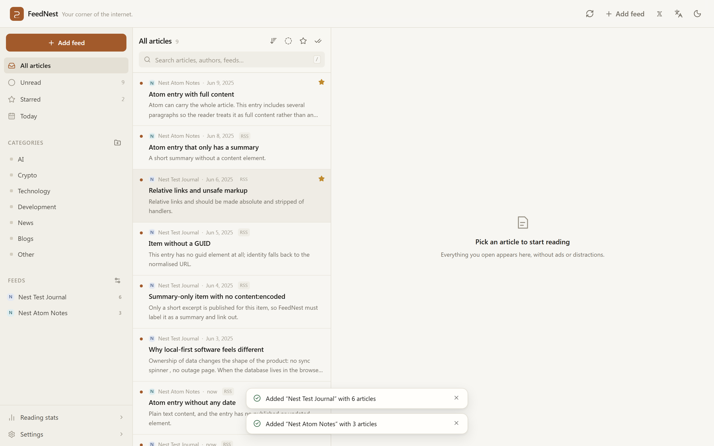
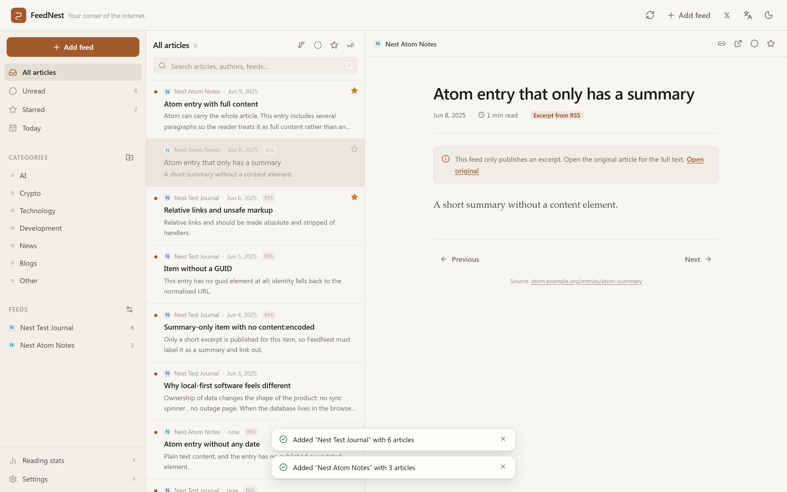
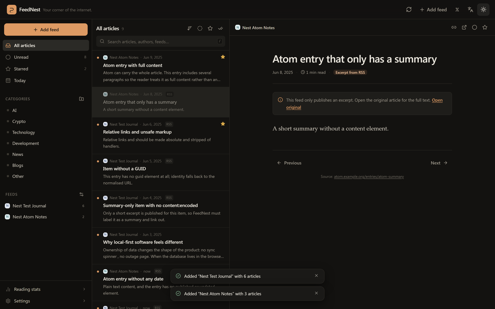
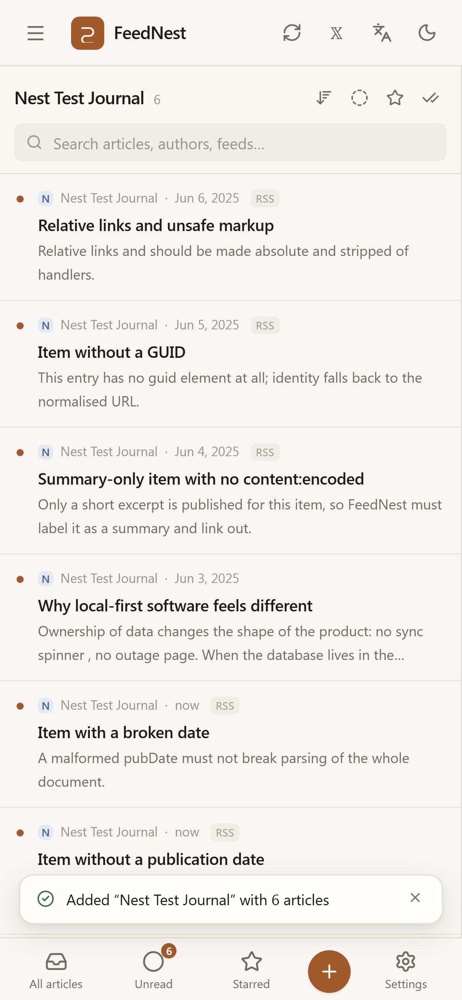
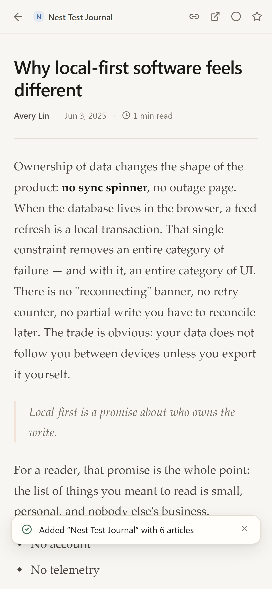
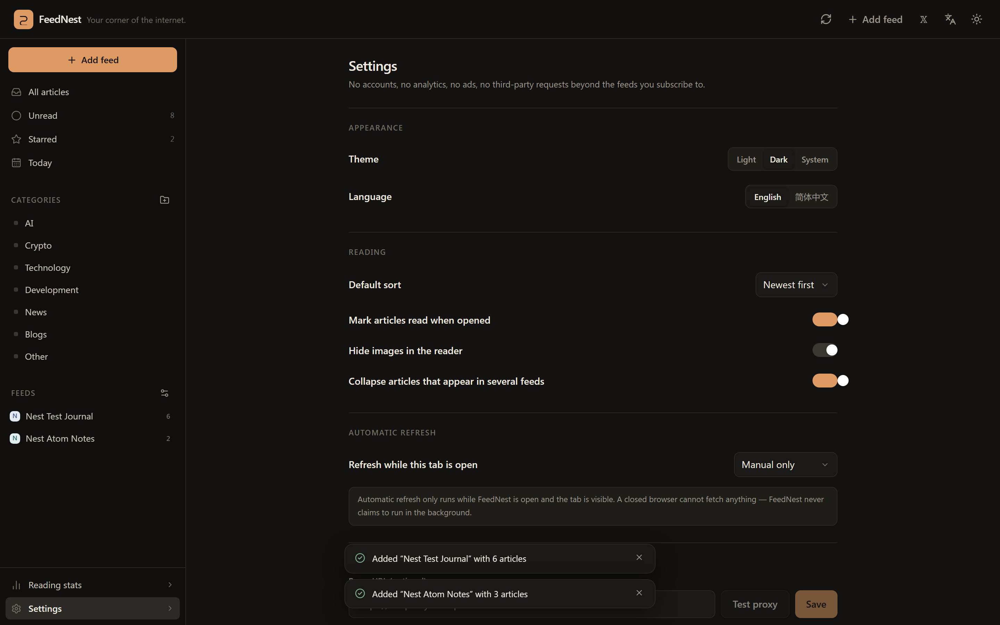

<div align="center">

# 🪺 FeedNest

**Your corner of the internet.**
_把值得阅读的内容，收进自己的信息空间。_

[](https://github.com/iiiiiiiiiiiiiKK/feednest/actions/workflows/ci.yml)
[](https://github.com/iiiiiiiiiiiiiKK/feednest/actions/workflows/deploy.yml)
[](LICENSE)

[**Live app**](https://iiiiiiiiiiiiiKK.github.io/feednest/) · [中文说明](README.zh-CN.md) · [Author on 𝕏](https://x.com/0xkillcoin)

</div>



A personal RSS/Atom reader that lives entirely in your browser. No account, no
server, no tracking, no ranking algorithm — just the feeds you chose, stored in
IndexedDB on your own machine.

---

## Why another RSS reader?

Every mainstream reader wants an account, a sync backend, and a business model.
FeedNest takes the opposite trade: **your subscriptions and reading history never
leave your browser**. The entire "backend" is IndexedDB, which means:

- it works offline and starts instantly,
- there is no outage page, because there is no server,
- there is nothing to sign up for, and nothing to leak,
- "delete all my data" is a real, complete operation.

The cost is equally honest: data does not follow you between devices unless you
export it, and the browser's CORS rules decide which feeds can be fetched
directly. Both are handled explicitly below.

## Features

**Subscriptions**
- Add an RSS, Atom or RSS 1.0 (RDF) URL, or paste a website and let FeedNest
  discover its feed (`<link rel="alternate">` + the usual `/feed`, `/rss.xml`…).
- Titles, descriptions, site URLs and icons are read from the feed itself.
- Rename, re-categorise, pause, refresh and delete feeds; errors stay attached to
  the feed that caused them.
- The same feed cannot be added twice, even with tracking parameters or a
  trailing slash.

**Reading**
- Three-pane layout: navigation, dense article list, calm reader.
- Full-text search across titles, summaries, authors and feed names, with a `/`
  shortcut.
- Unread, starred, today, per-feed and per-category views; newest/oldest sort;
  "unread only" and "starred only" refinements.
- Read and starred state persist across reloads, and refreshing a feed never
  resurrects a read article as unread.
- Keyboard: `j`/`k` next/previous article, `m` toggle read, `s` toggle star,
  `Esc` close the reader, `/` search.
- Light and dark themes (system-aware), English and 简体中文.

**Data**
- OPML 2.0 import with a preview, duplicate detection and per-entry errors.
- OPML export grouped by category.
- Full JSON backup (feeds, articles, bodies, categories, settings) and restore
  with a dry-run plan, merge or replace.
- Separate exports for starred articles and read history.
- Real statistics from real local rows: feeds, unread, starred, new today and
  the last seven days of reading.

**Quietly correct**
- Article bodies live in their own table, so listing 20,000 articles never loads
  megabytes of HTML.
- Deduplication by GUID → normalised URL → title+date hash; cross-feed duplicates
  can be collapsed without losing either feed's read state.
- Feed HTML is sanitised twice (at ingest and at render) with DOMPurify.
- Per-feed exponential backoff on failure; one broken feed never stops the rest.
- Conditional requests (`ETag`/`If-Modified-Since`) so unchanged feeds cost one
  304 instead of a full download.

## Screenshots

| Reader (light) | Reader (dark) |
| --- | --- |
|  |  |

| Mobile list | Mobile reader | Settings |
| --- | --- | --- |
|  |  |  |

## The CORS constraint (please read this one)

A browser can only read a response from another origin when that server sends
`Access-Control-Allow-Origin`. Many popular feeds do, many do not, and **no
client-side trick can bypass it** — the response never reaches JavaScript.

FeedNest therefore ships two fetch modes:

| Mode | What it does |
| --- | --- |
| **Direct** (default) | `fetch()` from your browser. Works for CORS-enabled hosts, costs nothing, involves no third party. |
| **Optional proxy** | You deploy a ~150-line Cloudflare Worker (in [`proxy/`](proxy/)) and paste its URL into Settings. The worker enforces an SSRF guard, size and time limits, and stores nothing. |

When a host blocks the browser, FeedNest says so explicitly — the add-feed dialog
explains the CORS policy and points at the proxy option. It never pretends a feed
is broken when the real cause is a browser security rule.

Verified CORS-friendly examples you can add right away: `github.blog/feed`,
`simonwillison.net/atom/everything/`, `blog.google/technology/ai/rss`,
`sspai.com/feed`, `overreacted.io/rss.xml`, `dev.to/feed`.

> Automatic refresh only runs **while the tab is open**. A closed browser cannot
> fetch anything, so FeedNest does not claim 24/7 background sync. That is a
> property of the platform, not a missing feature.

## Tech stack

| Layer | Choice |
| --- | --- |
| UI | React 19 + TypeScript, Tailwind CSS v4 |
| Build | Vite 8 |
| Storage | IndexedDB via Dexie 4 |
| Feed parsing | `fast-xml-parser` + a hand-written RSS/Atom/RDF mapper |
| Sanitising | DOMPurify |
| Unit tests | Vitest + Testing Library + `fake-indexeddb` |
| E2E tests | Playwright (Chromium desktop + iPhone viewport) |
| Optional proxy | Cloudflare Workers (no bindings, no storage) |
| Hosting | GitHub Pages (static) |

### Architecture

```
┌──────────────────────────── browser ────────────────────────────┐
│  React UI  ──►  state/selectors (filter · sort · collapse)      │
│     │                 ▲                                         │
│     │                 │ useLiveQuery                            │
│     ▼                 │                                         │
│  Dexie  ──►  feeds · articles · bodies · categories · settings  │
│     ▲                                                           │
│     │  ingestItems (GUID → URL → hash dedupe)                   │
│  refresh engine  ──►  fetch (direct | proxy)  ──►  parseFeed    │
└─────────────────────────────────────────────────────────────────┘
```

Key modules:

| File | Responsibility |
| --- | --- |
| `src/lib/parse.ts` | RSS 2.0 / Atom 1.0 / RDF parsing, sanitising, identity keys |
| `src/lib/fetch.ts` | Direct + proxy transport, timeouts, size caps, backoff, discovery |
| `src/lib/db.ts` | Dexie schema, ingestion, dedupe, read/star state, categories |
| `src/lib/refresh.ts` | Bounded-concurrency refresh with per-feed isolation |
| `src/lib/opml.ts` · `src/lib/backup.ts` | Import/export, non-destructive restore planning |
| `src/state/selectors.ts` | Pure view/stats functions (unit-tested) |
| `proxy/src/guard.ts` | SSRF guard, redirect re-validation, response caps |

## Getting started

Requirements: Node.js 20.19+ (22 recommended) and npm.

```bash
git clone https://github.com/iiiiiiiiiiiiiKK/feednest.git
cd feednest
npm ci
npm run dev          # http://localhost:5173
```

Production build and local preview:

```bash
npm run build
npm run preview      # http://127.0.0.1:4173
```

Deploying to GitHub Pages is automated by
[`.github/workflows/deploy.yml`](.github/workflows/deploy.yml). The build uses
`VITE_BASE=/feednest/` because project pages live under a sub-path.

## Testing

```bash
npm run lint         # ESLint (React hooks + TypeScript rules)
npm run typecheck    # tsc --noEmit
npm test             # 156 Vitest tests
npm run test:e2e     # builds, then runs Playwright
```

The suite covers the areas the product spec calls out, with real fixtures rather
than mocks of the parser:

- RSS 2.0, Atom 1.0 and RSS 1.0 parsing, including `content:encoded`,
  `media:content`, CDATA, entities and namespaced `dc:` elements
- invalid documents: HTML instead of a feed, malformed XML, empty bodies,
  feeds without items
- duplicate subscriptions (including tracking-parameter variants)
- article dedupe by GUID, URL fallback and hash fallback; GUID-less items;
  re-ingest after content edits; read/star state preservation
- RFC-822 / RFC-3339 / epoch / broken dates, with a fetch-time fallback
- read, starred, mark-all-read and per-date bulk operations
- category create/rename/delete (deleting a category never deletes feeds)
- OPML import (nested outlines, in-file duplicates, per-entry errors) and export
- JSON backup/restore, dry-run planning, merge and replace
- IndexedDB persistence across a close/reopen cycle
- CORS/timeout/HTTP/size-limit classification, proxy fallback, redirect guard
- search ranking, duplicate collapsing, statistics
- the Cloudflare Worker: SSRF guard, redirect re-validation, rate limiting,
  content-type filtering

Playwright runs two projects — desktop Chromium and an iPhone viewport — against
a local fixture server (`scripts/fixture-server.mjs`) that serves feeds with and
without CORS headers, so no test depends on a third-party feed being online.

The deployed site can be smoke-tested directly:

```bash
node scripts/verify-production.mjs
# 13 checks: page shell, real CORS feed, star/read persistence after reload,
# console errors, X link, mobile overflow, mobile reader full-screen
```

## Privacy and security

- No account, no analytics, no ads, no telemetry, no third-party requests beyond
  the feeds you subscribe to.
- Feed HTML is sanitised with a strict allow-list; scripts, iframes, inline
  styles and event handlers are removed, and links get
  `rel="noopener noreferrer nofollow"`.
- The optional proxy blocks loopback/private/link-local/metadata addresses,
  rejects credentials and odd ports, re-validates every redirect, caps response
  size and time, and never caches or logs article content.
- Settings → *Delete all local data* removes every feed, article, body, category
  and setting from this browser.

## Known limitations

- **Data is per browser profile.** Use the JSON backup to move it, or to keep a
  copy before clearing site data.
- **CORS decides what works in direct mode.** Some feeds genuinely require the
  proxy; FeedNest says which and why.
- **No background sync.** Refreshes happen while a tab is open and visible.
- **No full-text extraction.** If a feed only ships a summary, the reader labels
  it and links to the original. Article scraping is deliberately out of scope.
- **No podcast/audio player, no rules engine, no tags.** Plain reading, done well.
- Search is a local prefix/AND index, not a full Lucene-style query language.

## Roadmap

Ideas that fit the local-first constraint: per-feed retention limits, a
"read later" queue with offline caching, share-target/PWA install prompts,
optional encrypted export, and a keyboard-navigable command palette.

## Contributing

Bug reports and pull requests are welcome — see [CONTRIBUTING.md](CONTRIBUTING.md).
Please keep changes offline-first and dependency-light.

## License

[MIT](LICENSE). All dependencies are MIT/ISC/Apache-2.0 compatible; see the
lockfile for the full tree.

---

<div align="center">

Made with care for people who still read feeds.

[𝕏 @0xkillcoin](https://x.com/0xkillcoin)

</div>
