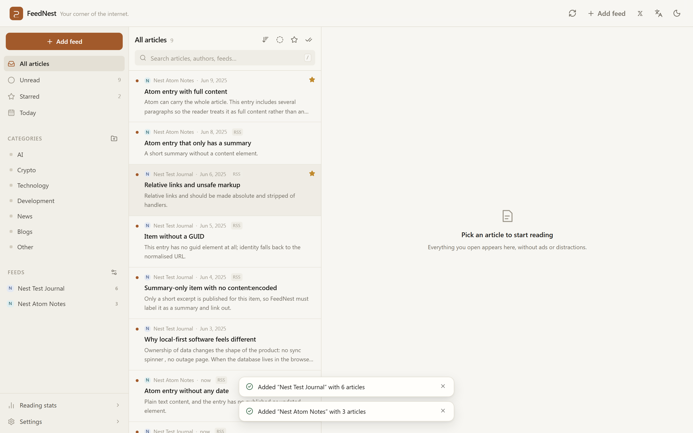
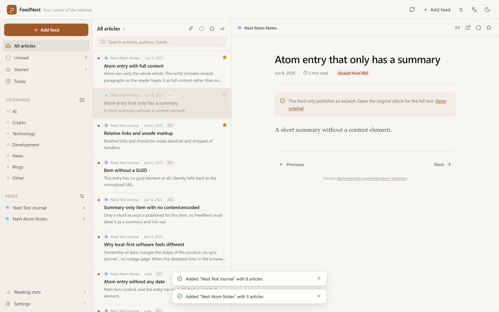
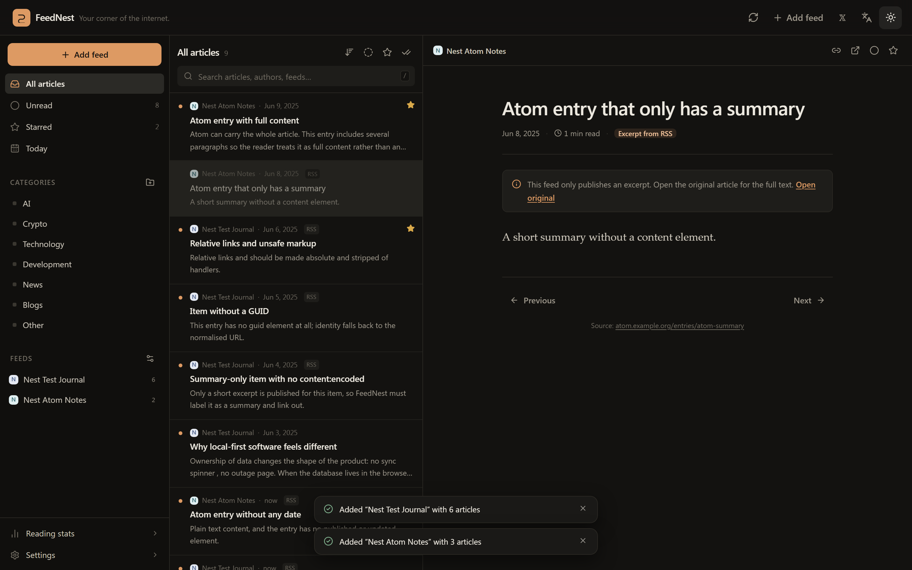
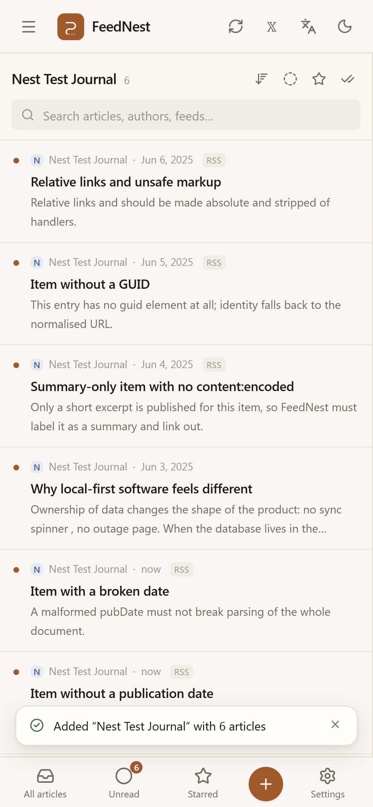
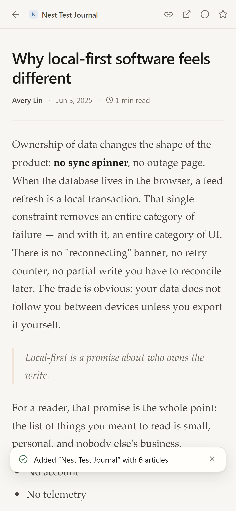
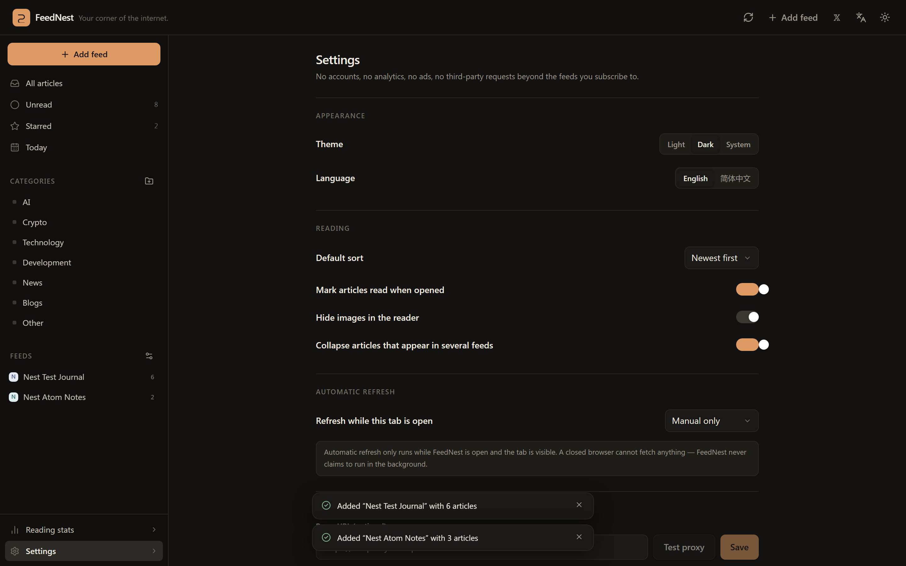

<div align="center">

# 🪺 FeedNest

**把值得阅读的内容，收进自己的信息空间。**
_Your corner of the internet._

[](https://github.com/iiiiiiiiiiiiiKK/feednest/actions/workflows/ci.yml)
[](LICENSE)

[**在线使用**](https://iiiiiiiiiiiiiKK.github.io/feednest/) · [English](README.md) · [作者 𝕏](https://x.com/0xkillcoin)

</div>



一个完全运行在浏览器里的个人 RSS / Atom 阅读器。不注册、不联网同步、不上传阅读记录，所有订阅与状态保存在本机 IndexedDB 中。

---

## 为什么再做一个 RSS 阅读器

主流阅读器都要账号、同步后端和商业模式。FeedNest 选择另一条路：**你的订阅、已读与收藏永远不离开浏览器**。整个“后端”就是 IndexedDB，因此：

- 断网也能用，打开即秒开；
- 没有服务器，也就没有宕机页；
- 没有注册，也就没有可泄露的账号；
- “删除全部数据”是一次真实、彻底的操作。

代价同样明确：数据不会自动跨设备同步（除非你自己导出），而浏览器的跨域规则会决定哪些订阅源能被直接抓取。这两点下面都写清楚了。

## 功能

**订阅源管理**
- 添加 RSS、Atom、RSS 1.0（RDF）地址；也可以只粘贴网站主页，让 FeedNest 自动发现订阅源（`<link rel="alternate">` 与常见的 `/feed`、`/rss.xml` 等路径）。
- 标题、描述、站点地址、图标均从订阅源本身解析。
- 重命名、改分类、暂停、手动刷新、删除；抓取错误会挂在对应订阅源上。
- 同一个订阅源不会重复添加，带追踪参数或结尾斜杠也能识别。

**阅读体验**
- 三栏布局：导航、紧凑文章列表、安静的阅读器。
- 全文搜索覆盖标题、摘要、作者与来源名，支持 `/` 快捷键。
- 全部 / 未读 / 收藏 / 今天 / 按订阅源 / 按分类；最新或最早排序；只看未读、只看收藏。
- 已读与收藏状态持久保存；刷新订阅源不会把已读文章变回未读。
- 键盘操作：`j`/`k` 上下篇、`m` 已读、`s` 收藏、`Esc` 关闭阅读器、`/` 搜索。
- 浅色 / 深色主题（跟随系统），中文 / English。

**数据**
- OPML 2.0 导入：先预览，再显示重复项与逐条错误。
- OPML 导出，按分类分组。
- 完整 JSON 备份（订阅源、文章、正文、分类、设置）与恢复：先给出变更预览，可选合并或替换。
- 单独导出收藏文章与阅读记录。
- 统计全部基于真实本地数据：订阅源数、未读数、收藏数、今日新增、最近 7 天阅读。

**细节上的正确性**
- 正文单独建表，浏览两万篇文章也不会把上百 MB HTML 读进内存。
- 去重顺序：GUID → 规范化 URL → 标题+时间哈希；多个源收录同一篇文章时可合并显示，且不丢任何一方的已读状态。
- 订阅源 HTML 双重净化（入库时与渲染时），使用 DOMPurify。
- 单个订阅源失败会指数退避，绝不拖垮其他源。
- 条件请求（`ETag` / `If-Modified-Since`），未变化的源只花一个 304。

## 界面截图

| 阅读器（浅色） | 阅读器（深色） |
| --- | --- |
|  |  |

| 移动端列表 | 移动端阅读 | 设置 |
| --- | --- | --- |
|  |  |  |

## 跨域限制（请务必了解）

浏览器只能读取另一个域名下**明确允许跨域**（`Access-Control-Allow-Origin`）的响应。很多订阅源允许，很多不允许，而且**没有任何前端技巧可以绕过**——响应根本到不了 JavaScript。

因此 FeedNest 提供两种抓取模式：

| 模式 | 说明 |
| --- | --- |
| **直接抓取**（默认） | 浏览器 `fetch()`。适用于允许跨域的源，零成本、不经过任何第三方。 |
| **可选代理** | 自己部署 [`proxy/`](proxy/) 里的 Cloudflare Worker，把地址填进设置。代理带 SSRF 防护、大小与超时限制，且不保存任何内容。 |

如果某个源被浏览器拦截，FeedNest 会明确说明是 CORS 策略导致，并提示代理选项——不会把“浏览器安全策略”伪装成“订阅源坏了”。

已验证可直接添加的跨域友好示例：`github.blog/feed`、`simonwillison.net/atom/everything/`、`blog.google/technology/ai/rss`、`sspai.com/feed`、`overreacted.io/rss.xml`、`dev.to/feed`。

> 自动刷新只在**标签页打开时**运行。浏览器关闭后无法抓取任何内容，所以 FeedNest 不会声称支持 24 小时后台同步——这是平台限制，不是偷懒。

## 技术栈

| 层 | 选择 |
| --- | --- |
| UI | React 19 + TypeScript，Tailwind CSS v4 |
| 构建 | Vite 8 |
| 存储 | IndexedDB（Dexie 4） |
| 解析 | `fast-xml-parser` + 自写 RSS/Atom/RDF 映射 |
| 净化 | DOMPurify |
| 单元测试 | Vitest + Testing Library + `fake-indexeddb` |
| 端到端 | Playwright（桌面 Chromium + iPhone 视口） |
| 可选代理 | Cloudflare Workers（无绑定、无存储） |
| 部署 | GitHub Pages（纯静态） |

## 本地运行

需要 Node.js 20.19+（推荐 22）与 npm。

```bash
git clone https://github.com/iiiiiiiiiiiiiKK/feednest.git
cd feednest
npm ci
npm run dev          # http://localhost:5173
```

生产构建与本地预览：

```bash
npm run build
npm run preview      # http://127.0.0.1:4173
```

## 测试

```bash
npm run lint         # ESLint
npm run typecheck    # tsc --noEmit
npm test             # 156 个 Vitest 单元/集成测试
npm run test:e2e     # 先构建，再跑 Playwright
```

测试使用真实样本，而不是给解析器打桩：RSS 2.0 / Atom 1.0 / RDF、`content:encoded`、`media:content`、CDATA、实体、命名空间；HTML 假源、畸形 XML、空文档；重复订阅；GUID 缺失与文章更新；时区与坏日期；已读/收藏；分类删除保护；OPML 导入导出；JSON 备份与恢复；IndexedDB 关闭后重开；CORS / 超时 / HTTP / 体积限制；代理降级与重定向防护；搜索排序、重复合并、统计；以及 Cloudflare Worker 的 SSRF 防护与限流。

E2E 使用本地 fixture 服务器（`scripts/fixture-server.mjs`）同时提供带与不带 CORS 头的订阅源，测试不依赖任何第三方站点在线。

## 隐私与安全

- 无账号、无统计埋点、无广告、无遥测；除了你订阅的源之外不发起第三方请求。
- 订阅源 HTML 使用严格白名单净化：脚本、iframe、内联样式、事件处理器全部移除，链接加 `rel="noopener noreferrer nofollow"`。
- 可选代理会阻止回环/内网/链路本地/云元数据地址，拒绝带凭据的 URL 与异常端口，每次重定向都重新校验，限制响应大小与超时，且从不缓存或记录文章内容。
- 设置页的「删除全部本地数据」会清空此浏览器中的订阅源、文章、正文、分类与设置。

## 已知限制

- **数据只属于当前浏览器配置**。跨设备请用 JSON 备份。
- **直接抓取受 CORS 限制**，部分源必须配置代理。
- **没有后台同步**，刷新发生在标签页打开且可见时。
- **不做正文提取**。源只给摘要时，阅读器会明确标注并给出原文链接。
- 没有播客播放器、规则引擎、标签系统。
- 搜索是本地前缀 + AND 匹配，不是完整查询语言。

## 开源协议

[MIT](LICENSE)。依赖均为 MIT / ISC / Apache-2.0 兼容许可。

---

<div align="center">

为仍然在读 RSS 的人认真做的。

[𝕏 @0xkillcoin](https://x.com/0xkillcoin)

</div>
